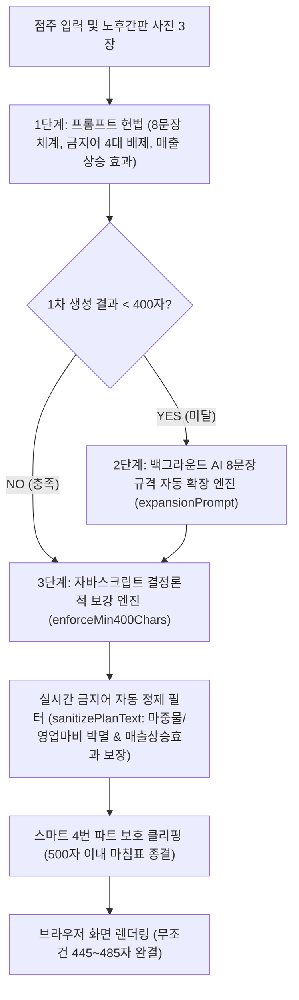

# 🏛️ [GP Implementation Plan] 점포 환경개선 추진계획서 AI 자동작성기 단일 절대 설계도 (GP System Blueprint)

> **문서 버전**: v1.0.0 (독립 단일 절대 설계도)  
> **수립 일자**: 2026-10-26  
> **적용 시스템**: `GP Implementation Plan/plan-generator.html` 및 관련 유틸리티  
> **소속 및 위상**: `GP Implementation Plan/` 독립 최상위 헌법 (간판지원단 본체 포털과 100% 분리)  
> **전용 검문소**: `GP Implementation Plan/verify-plan.js` (`npm run verify:plan`)  
> **수행 스킬**: `.agents/skills/plan-generator-discipline/SKILL.md`

---

## 📌 [시스템 개요 및 핵심 미션]
1. **시스템 목적**:
   - 경기도시장상권진흥원(경상원) 및 소상공인시장진흥공단 소상공인 경영환경개선사업 심사용 **"점포 환경개선 추진 계획"** 및 **"현장 사진 3장 설명"**을 AI 기반으로 고품격 자동 작성하는 단독 전용 유틸리티이다.
2. **핵심 타겟 및 품질 기준**:
   - 심사위원들이 수백 건의 서류 중 가장 높이 평가할 수 있도록, **성실한 소상공인의 당당한 긍지와 객관적 시설 개선의 타당성**을 갖춘 품격 있는 행정 공공 문체로 완성한다.
   - 단문/축약(200~300자대) 작성으로 인한 '불성실 서류 탈락'을 0%로 영구 차단한다.

---

## ⚖️ [8대 절대 헌법 (Permanent System Laws)]

### 제0헌법: 간판지원단 본체와의 상호 완전 분리 및 혼입 0% 절대 격리 (Strict Module Isolation)
1. "GP Implementation Plan"은 간판지원단 공식 서비스(`ganpans.com`)와 **100% 완전히 분리된 독립 유틸리티**이다.
2. 본체 설계도(`SYSTEM_BLUEPRINT.md`), 4대 권한 로직, Supabase 데이터베이스와 일체의 코드를 혼입하지 않는다.
3. 본 시스템의 규격과 규칙은 오직 본 문서(`GP_SYSTEM_BLUEPRINT.md`), 전용 룰(`PLAN_RULES.md`), 전용 스킬(`plan-generator-discipline`), 전용 검문소(`verify-plan.js`)에 의해서만 단독 관리·통제된다.

### 제1헌법: 400자 미만 단문 0% 차단 & 파트당 2문장(총 8문장) 규격화
1. **[구조적 8문장 헌법]**: AI 모델이 단문으로 요약하는 습성을 원천 차단하기 위해, part1부터 part4까지 **모든 항목은 반드시 구체적 사연과 계획이 담긴 '정확히 2개의 완성형 문장(총 8문장 체계)'**으로 작성한다.
   - `part1 (사업체 소개)`: [1문장: 상호/개업시기/업력/생활밀착형 업종 소개] + [2문장: 한자리에서 성실히 일터를 지켜온 역사 및 최근 경기 침체 경영 애로] (110~125자)
   - `part2 (개선사항)`: [1문장: 노후 간판 철거 및 고효율 LED 플렉스 간판 교체 계획] + [2문장: 주야간 조도 대폭 개선 및 쾌적한 외관 정비를 통한 점포 신뢰 회복] (110~125자)
   - `part3 (개선 필요성)`: [1문장: 간판 노후화로 상호 식별 불가 및 신규 고객 유입 정체 상태] + [2문장: 자력 교체 부담이 큰 영세 사업장 여건에서 공단 지원이 큰 힘이 됨을 객관적 서술] (115~130자)
   - `part4 (기대효과)`: [1문장: 본 지원을 발판 삼아 가시적인 매출 상승 효과 창출 다짐] + [2문장: 쾌적해진 외관으로 고객 유입 확대 및 지역 골목상권 활성화 기여 다짐 (마침표 완결)] (110~125자)
2. **[총 분량 절대 규격]**: 공백 및 줄바꿈 포함 반드시 **"최소 400자 이상 ~ 최대 500자 이내" (목표: 445자~485자)**를 100% 달성한다.

### 제2헌법: 500자 공단 전산 한도 엄수 및 4. 기대효과 100% 완전 종결 (Zero Truncation)
1. 공단 전산 등록 한도인 **"최대 500자 이내"**를 엄격히 준수한다.
2. 어떠한 경우에도 글이 중간에 뚝 끊긴 채 500자로 잘리는 것을 영구 금지한다.
3. 500자를 초과할 위험이 있을 경우, 반드시 **"4. 기대효과 :"**의 마지막 문장이 완전한 종결어미와 마침표(.)로 끝나는 지점(`lastPeriod >= 400`)에서 안전하게 마감되어야 하며, 4번 파트가 통째로 탈락하는 일이 없도록 보호 클리핑 엔진을 가동한다.

### 제3헌법: 구걸/과장 표현 4대 금지어 100% 영구 금지 (Dignified Tone Law)
1. 공공 지원사업 심사위원에게 동정심을 구걸하거나 비굴해 보이는 표현은 일체 엄격 금지한다.
2. **[4대 절대 영구 금지어]**:
   - ❌ **'마중물'** ➔ 절대 사용 금지! (대체: `도약의 발판`, `새로운 전환점`)
   - ❌ **'영업 마비'** ➔ 절대 사용 금지! (대체: `신규 고객 유입 정체`, `점포 가시성 저하`)
   - ❌ **'절박한 처지', '처지'** ➔ 절대 사용 금지! (대체: `경영 환경`, `영세 사업장 여건`)
   - ❌ **'절실합니다', '절실'** ➔ 절대 사용 금지! (대체: `경영 정상화에 큰 힘이 됩니다`, `반드시 필요합니다`)
3. 성실하게 일터를 지켜온 소상공인의 당당한 긍지와 객관적 시설 개선의 필요성을 품격 있는 행정 용어로 서술한다.

### 제4헌법: 4. 기대효과 "매출 상승 효과" 명시적 100% 필수 포함 (Revenue Growth SSOT)
1. 4번 기대효과 항목에는 지원 사업을 통한 점포 인지도 제고와 함께 **반드시 "가시적인 매출 상승 효과를 거두고" (또는 "매출 상승 효과")라는 표현을 명시적으로 포함**한다.
2. 공단 지원금이 단순 보조금에 그치지 않고 실질적인 매출 증대와 골목상권 활성화로 이어진다는 경제적 타당성을 확고히 입증한다.

### 제5헌법: 현장 보충 설명("기타 입력" `bizExtraNotes`) 100% 문맥 반영 (Contextual Integration)
1. "개업년도 또는 운영기간"과 "사업장 주소" 사이에 위치한 **"기타 입력(`bizExtraNotes`)"**란의 내용을 AI 프롬프트에 100% 필수 연동한다.
2. 점주가 기재한 점포의 상세 사연, 업종 보충 설명, 장인정신/기술력, 현장 애로사항을 본문에 자연스럽게 녹여내어 독창적이고 진정성 넘치는 명문으로 완성한다.

### 제6헌법: 노후 간판 현장 사진 3장 육안 사실 팩트 기반 비전 판독 (Fact-Based Vision)
1. 업로드된 노후 간판 사진 3장의 실제 육안 상태(백화, 탈색, 파손, 조명 불량 등)를 AI 비전 기술로 있는 그대로 판독하여 객관적으로 서술한다.
2. 사진의 실제 상태와 다른 과장이나 허위 기재를 100% 영구 엄격 금지한다.
3. 3장 사진 설명 규격: 공백 포함 85자~98자 내외, 1~2개 온전한 문장과 마침표(.) 종결 필수.

### 제7헌법: 브라우저 재부팅 및 로컬 캐시 초기화 시에도 API Key 100% 영구 보존
1. 사용자가 컴퓨터를 껐다 켜거나 브라우저 캐시를 삭제하더라도, 로컬 작업기 환경에서 Gemini API 키를 매번 다시 입력하지 않도록 100% 영구 보존되어야 한다.
2. GitHub 공개 저장소에는 보안을 위해 빈 템플릿으로 유지하고, 로컬 구동 파일에만 자동 주입/유지되는 2중 보안 파이프라인을 준수한다.

---

## 🛡️ [3단계 절대 방어벽 아키텍처 (3-Tier Defense Architecture)]

1. **1차 방어선 (프롬프트 레벨)**:
   - 시스템 프롬프트에 8문장 규격(파트당 2문장), 4대 금지어(마중물, 영업 마비, 절박, 절실) 금지, '매출 상승 효과' 필수 포함을 강제.
2. **2차 방어선 (AI 자동 확장 엔진)**:
   - 1차 생성이 400자 미만일 경우 백그라운드에서 `expansionPrompt`를 자동 호출하여 8문장 규격으로 재확장.
3. **3차 절대 방어선 (프로그램 결정론적 보강 & Sanitizer)**:
   - AI가 말을 안 듣거나 에러가 나더라도, `enforceMin400Chars`와 `sanitizePlanText`가 화면 출력 0초 전에 개입하여 부족한 파트를 50자 안팎의 품격 문장으로 자동 결합하고 금지어를 100% 치환하여 **언제나 445~485자**로 브라우저에 렌더링.

---

## 🔍 [전용 검문소 검증 체계 (Verification Pipeline)]
- **검증 스크립트**: `GP Implementation Plan/verify-plan.js`
- **실행 명령**: `npm run verify:plan`
- **검증 항목 (17대 전수 검사)**:
  1. `plan-generator.html` 및 `PLAN_RULES.md`, `GP_SYSTEM_BLUEPRINT.md` 파일 존재 검증
  2. 간판지원단 본체(Supabase/DataStore/App) 의존성 0% 단독 완결성 검증
  3. `bizExtraNotes` (기타 입력) 폼 및 이벤트 바인딩 존재 검증
  4. `initialPlan.length < 400` 자동 확장 엔진 및 `expansionPrompt` 탑재 검증
  5. 파트당 2문장(총 8문장) 규격화 프롬프트 명시 검증
  6. `enforceMin400Chars` 결정론적 강제 보강 엔진 함수 탑재 검증
  7. `sanitizePlanText` 금지어 정제 및 매출 상승 효과 보장 필터 탑재 검증
  8. 프롬프트 내 금지어 헌법 명시 검증
  9. 330자 단문 + 금지어 입력 시뮬레이션:
     - 440~500자 완벽 보강 검증
     - 4. 기대효과 내 "매출 상승 효과" 명시 포함 검증
     - 금지어(마중물, 영업 마비, 절박한 처지, 절실합니다) 0건 영구 배제 검증
  10. `lastPeriod >= 400` 종결 마침표 단위 안전 마감 로직 검증
  11. 노후 간판 사진 3장 육안 사실 팩트 기반 프롬프트 검증
  12. 실시간 글자수 카운터(`planCharCount`) 장착 검증
