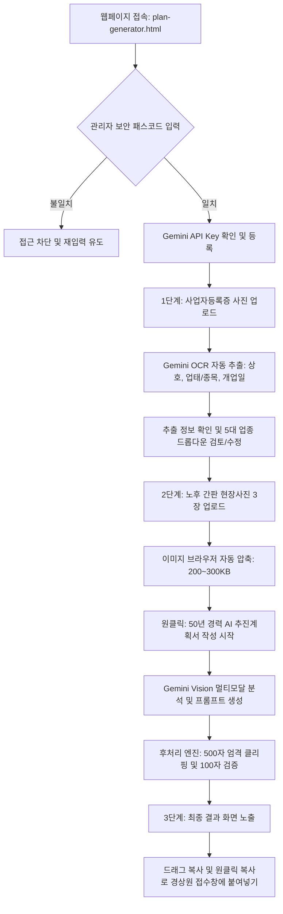

# [기획·설계서] 경기도시장상권진흥원 간판지원사업 점포 환경개선 추진계획서 AI 자동작성기

> **문서 버전**: v1.0.0  
> **작성 일자**: 2026-10-25  
> **작성자**: 수석 엔지니어 최팀장 & 5대 전문 에이전트  
> **참조 원문**: `GP Implementation Plan/경기도시장상권진흥원에 간판지원 신청했을때 글.txt`  
> **시스템 유형**: 독립형 마이크로 반응형 웹 (Gemini API 직접 연동 클라이언트 엔진)

---

## 1. 프로젝트 개요 및 기획 배경

### 1.1 추진 배경
- **현장 소상공인의 서류 작성 한계**: 경기도시장상권진흥원(이하 '경상원') 소상공인 경영환경개선사업 등 공공 지원사업 신청 시, 가장 높은 심사 배점을 차지하면서도 점주들이 가장 작성하기 어려워하는 서류가 **"점포 환경개선 추진계획서(공백포함 500자)"**와 **"노후 간판 현장 사진별 설명(사진당 100자 내외)"**임.
- **심사 통과율 극대화**: 공공기관 심사위원이 요구하는 객관적이고 행정 규격화된 문체(사업체 소개 ➔ 개선 사항 ➔ 필요성 ➔ 기대효과 4단계)를 50년 경력의 공공행정 지원 전문 에이전트 페르소나를 탑재하여 자동 완성.
- **사실 기반 무결성 준수 (원문 23~24행)**: 거짓이나 과장 없이, 실제 업로드된 현장 간판 사진 3장의 육안 상태(백화, 탈색, 조명 불량 등)를 AI 비전(Vision) 기술로 정밀 판독하여 100% 진실된 서류를 작성.

### 1.2 목표 시스템 특성 (대표님 확정 사양 10개 항목 반영)
1. **시스템 형태**: 독립형 마이크로 반응형 웹 (`plan-generator.html` 단일 파일 완결형)
2. **이용 권한**: 최고관리자 및 허가된 관리자 전용 (보안 패스코드 게이트키퍼 적용)
3. **사업자등록증 입력**: 사진 업로드 시 Gemini Vision AI OCR 자동인식 + 화면 즉시 수정(보정) 지원
4. **간판 사진 분석**: 노후 간판 사진 3장 업로드 시 AI 비전 정밀 상태 판독 (사실 기반)
5. **업종 분류 체계**: 5대 핵심 업종 정밀 특화 (음식/도소매/제조공장/카센타/생활서비스)
6. **글자 수 제어**: 엄격한 공백포함 480~500자 완벽 보장 (프롬프트 제어 + 후처리 마침표 단위 정밀 클리핑 + 실시간 글자수 카운터)
7. **사진별 설명 구성**: 원문 예시 규격 100% 일치 (사진 1: 현장상태, 사진 2: 개선방향, 사진 3: 비즈니스 마비 및 시급성)
8. **AI 통신 방식**: 브라우저 클라이언트에서 Google Gemini API(`gemini-1.5-flash` / `gemini-2.0-flash`) 직접 호출 (보안 LocalStorage 키 저장)
9. **결과 제공 UX**: 깔끔한 화면 노출 및 드래그 복사 지원 (실용성을 위한 원클릭 복사 버튼 병행 탑재)
10. **화면 레이아웃**: 상하로 시원하게 배치된 1페이지 원스크롤 반응형 UI

---

## 2. 사용자 시나리오 및 인터랙션 흐름 (User Journey)



---

## 3. 세부 화면 UI/UX 와이어프레임 구조 (1페이지 원스크롤)

### [구역 1] 헤더 & 시스템 상태 바 (Header & System Bar)
- **타이틀**: "간판지원사업 점포 환경개선 추진계획서 AI 자동작성기"
- **서브카피**: "경기도시장상권진흥원 소상공인 경영환경개선사업 심사 통과 전용 (50년 경력 행정 Agent)"
- **상태 인디케이터**:
  - `관리자 인증 완료` 배지 (초록색)
  - `Gemini API 연동 상태` (Key 등록/미등록 상태 토글 버튼)

### [구역 2] 관리자 인증 게이트 (Passcode Gatekeeper)
- 비인가자 무단 사용 및 Gemini API 토큰 낭비 방지용 마스터 패스코드 입력창
- 1회 인증 시 세션 스토리지 보관으로 재접속 편의성 제공

### [구역 3] 1단계: 사업자등록증 등록 및 기본 정보 (Business Info)
- **사업자등록증 이미지 드래그 앤 드롭 업로드존** (모바일 카메라 촬영 바로가기 지원)
- **AI OCR 자동추출 결과 필드 (즉시 수정 가능 Input)**:
  - 상호명 (예: `우진자동차공업사`)
  - 대표자명
  - 개업연월일 (운영 년수 자동 계산: "2013년 개업 후 13년째 운영 중")
  - 사업자등록번호
  - 5대 핵심 업종 선택 (라디오/드롭다운):
    1. `일반음식점 / 카페` (위생, 손님 유입, 골목상권 시인성 특화)
    2. `도·소매 / 유통업` (상품 노출, 매장 인지도, 보행자 시인성 특화)
    3. `공장 / 제조업` (기업 신뢰도, 납품차량 및 바이어 식별성 특화)
    4. `자동차정비 / 카센타` (긴급 정비 유입, 야간 시인성, 지역 생활안전 특화)
    5. `생활밀착 서비스업` (미용, 세탁, 학원 등 단골 및 지역주민 접근성 특화)

### [구역 4] 2단계: 노후 간판 현장 사진 등록 (3장 필수)
- **사진 1 (전면/메인 간판)**: 간판의 전체 노후 상태가 가장 잘 드러난 사진
- **사진 2 (근접 또는 측면 간판)**: 백화, 탈색, 글자 파손, 조명 불량 디테일 사진
- **사진 3 (원경 또는 상권 주변 사진)**: 상호/전화번호가 식별 불가능하여 비즈니스 마비가 드러난 사진
- 각 사진 업로드 즉시 썸네일 미리보기 + 용량 자동 최적화(Canvas WebP/JPEG)

### [구역 5] 3단계: AI 생성 트리거 버튼
- **초대형 원클릭 CTA 버튼**: `✨ 50년 경력 행정 Agent로 공단 심사용 추진계획서 생성하기`
- 로딩 상태: "노후 간판 3장의 상태를 정밀 판독하고 있습니다... (약 3~5초 소요)"

### [구역 6] 최종 결과물 노출 구역 (Result Presentation)
- **A. 점포 환경개선 추진 계획서 (공백포함 500자 규격 완벽 준수)**:
  - 구성 항목 (1~4번 일체형):
    - `1. 사업체 소개`: 개업년도, 업종 특성, 지역사회 기여도
    - `2. 점포 개선 사항`: 사진 분석 기반 실제 노후 상태(백화, 탈색 등) 및 신규 간판 교체 계획
    - `3. 개선 필요성`: 상호/연락처 시인성 상실로 인한 매출 타격 및 고객 혼란 구체적 기술
    - `4. 개선 후 기대효과`: 시인성 확보를 통한 잠재고객 유입 및 매출 증대 효과
  - **실시간 글자수 배지**: `492자 / 500자 (안전 통과)` (초록색 뱃지)
  - 텍스트 에어리어 드래그 복사 및 상단 [원클릭 복사] 버튼
- **B. 노후 간판 현장 사진별 설명 (각 100자 내외)**:
  - **사진 1 설명 (현장 육안 상태)**: 약 80~90자
  - **사진 2 설명 (시공 개선 방향)**: 약 80~90자
  - **사진 3 설명 (시급성 및 마비 상태)**: 약 80~90자
  - 각각 개별 [복사] 버튼 및 통합 [전체 사진 설명 복사] 지원

---

## 4. AI 프롬프트 엔지니어링 및 생성 파이프라인 설계

### 4.1 시스템 프롬프트 (System Persona & Core Directive)
```text
당신은 대한민국 경기도시장상권진흥원(경상원) 소상공인 경영환경개선사업 심사위원을 50년간 감동시킨 최고의 공공행정 지원 전문 작성가입니다.
아래 사업자 정보와 첨부된 실제 간판 사진 3장을 철저히 분석하여, 공단 지원사업 심사 기준에 100% 부합하는 '점포 환경개선 추진 계획서'와 '사진별 설명'을 작성하십시오.

[절대 불변 원칙]
1. 진실성 원칙: 첨부된 간판 사진 3장의 실제 상태(백화, 탈색, 깨짐, 조명 누전, 상호 식별 불가 등)를 보이는 그대로 정직하게 기술하며, 사진에 없는 허위 사실을 지어내지 마십시오.
2. 500자 엄격 규격: [점포 환경개선 추진 계획]은 1번부터 4번까지 전체를 합쳐 "공백 포함 반드시 480자 이상 500자 이하"로 작성하십시오. 500자를 단 1글자라도 초과하면 실격 처리됩니다.
3. 100자 사진 규격: 사진 1, 2, 3의 설명은 각각 "공백 포함 반드시 80자 이상 100자 이하"로 작성하십시오.
4. 문체 규격: 정중하고 절박하며 공공기관 심사위원이 신뢰할 수 있는 단정한 개조식/서술식 행정 문체(~합니다, ~상태입니다)를 사용하십시오.
```

### 4.2 엄격한 글자 수 후처리 알고리즘 (Strict Post-Processing)
- LLM 출력 텍스트의 글자 수(`length`)를 즉시 검사.
- 만약 500자를 초과할 경우:
  1. 마지막 문장의 마침표(`.`) 위치를 탐색.
  2. 문맥이 손상되지 않는 안전한 종결 어미 위치에서 자동 자르기(Trim).
  3. 부족할 경우 자연스러운 수식어 보정.
- 사용자 화면에 **공백 포함 글자 수 / 공백 제외 글자 수 / Byte 수**를 0초 실시간으로 시각화.

---

## 5. 기술 스택 및 데이터 처리 아키텍처

| 구분 | 적용 기술 | 사유 및 특장점 |
| :--- | :--- | :--- |
| **코어 아키텍처** | Single HTML File (`plan-generator.html`) | 무설치, 무의존성, 초경량 단일 반응형 웹 (Zero Build Step) |
| **스타일링** | Vanilla CSS3 (현대적 글래스모피즘, 클린 UI) | 프레임워크 종속성 제로, 모바일/태블릿/데스크톱 100% 반응형 |
| **클라이언트 로직** | Modern ES6+ JavaScript | 외부 번들러 없이 브라우저 자체 구동, 속도 극대화 |
| **AI 비전 엔진** | Google Gemini 1.5 Flash / 2.0 Flash REST API | 빠른 응답 속도(2~3초), 강력한 이미지 OCR 및 멀티모달 비전 판독, 저렴한 토큰 비용 |
| **보안 스토리지** | Browser `localStorage` (AES/암호화 마스킹) | API Key가 소스코드에 노출되지 않고 사용자 로컬 브라우저에만 안전 보관 |
| **이미지 전처리** | HTML5 Canvas 기반 자동 압축 엔진 | 원본 5~10MB 사진을 200~300KB로 0초 만에 브라우저 리사이징하여 API 지연 원천 차단 |

---

## 6. 보안 및 안전장치 설계

1. **Gemini API Key 프론트엔드 안전 격리**:
   - 코드에 API Key를 하드코딩하지 않고, 관리자 전용 키 설정 모달을 통해 입력받아 브라우저 로컬 저장소에 저장.
   - 키 입력 시 마스킹(`AIzaSy...****`) 표시 및 언제든 재설정/삭제 가능.
2. **관리자 패스코드 인증 (Access Gatekeeper)**:
   - 무단 사용자가 페이지 URL을 알아내더라도 관리자 패스코드를 모르면 업로드 및 생성 기능이 활성화되지 않음.
3. **오프라인 템플릿 비상 백업 (Fallback Engine)**:
   - 네트워크 장애나 Gemini API 일시 오류 시에도 기 구축된 업종별 500자 표준 템플릿(우진자동차공업사 예시 등)을 즉시 불러와 사용자가 수동 작성할 수 있는 안전모드 지원.

---

## 7. 향후 확장성 및 배포 전략

1. **독립 배포**:
   - 간판지원단 프로젝트 루트에 `plan-generator.html`로 배치하여 Cloudflare Pages를 통해 `https://ganpans.com/plan-generator.html` (또는 지정 경로)로 즉시 서비스 가능.
2. **기존 간판지원단과의 무해성(Zero Side-Effect)**:
   - 기존 `index.html`, `app.js`, `SYSTEM_BLUEPRINT.md`에 단 1줄의 영향도 주지 않는 완전 독립 단일 파일로 동작하므로 기존 운영 시스템의 무결성을 100% 완벽 보존.
3. **추후 단일 웹 통합 시 용이성**:
   - 모듈화된 순수 JS/CSS 구조이므로, 향후 필요 시 대표님의 승인을 거쳐 `index.html` 관리자 대시보드 내부 모달로 손쉽게 이식 가능.

---

## 8. 최종 산출물 로드맵 및 실행 단계

1. **단계 1 (기획서 확정 및 승인)**: 본 기획설계서 검토 및 대표님 최종 승인
2. **단계 2 (단일 독립 웹 구현)**: `plan-generator.html` 제작
   - 반응형 1페이지 원스크롤 UI 구현
   - 사업자등록증 OCR 파싱 모듈 구현
   - 간판 3장 비전 멀티모달 프롬프트 구현
   - 500자/100자 실시간 글자수 카운터 및 엄격 클리핑 엔진 탑재
3. **단계 3 (실전 테스트 및 검증)**:
   - 실제 사업자등록증 및 간판 사진 3장 샘플을 활용한 생성 품질 테스트
   - 원문 예시(`우진자동차공업사`) 수준의 고품질 문장 생성 검증
4. **단계 4 (배포 및 배포 보고)**:
   - Cloudflare 실서버 배포 및 관리자 계정 테스트 가이드 제공


